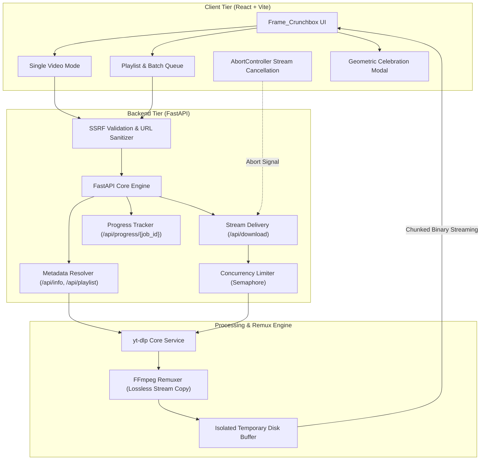
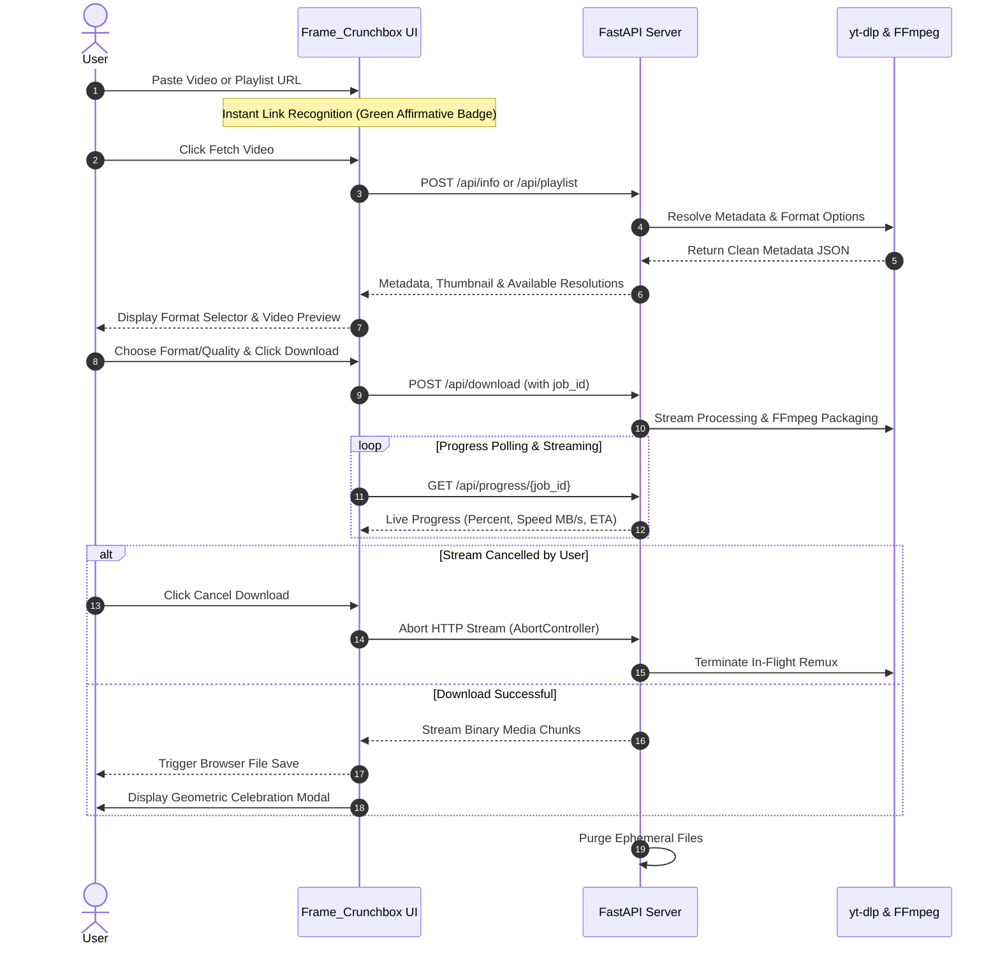

# Frame_Crunchbox — Modern Media Workbench & Downloader

A modern, high-performance web application designed with an editorial Bauhaus aesthetic to inspect public media metadata, discover available resolutions, and download individual videos or entire playlists as **MP4**, **WebM**, **MP3**, or **M4A** using **FastAPI**, **yt-dlp**, **FFmpeg**, and **React (Vite)**.

---

## 1. Architecture & System Overview



---

## 2. User Workflow & Lifecycle



---

## 3. Core Capabilities

- **Single Video & Full Playlist Queue**:
  - Download individual videos on demand (MP4, WebM, MP3, M4A).
  - Resolve complete public playlists (up to 50 items in seconds) and download entries individually or via automated batch queue.
- **Instant Download Cancellation**:
  - Cancel in-flight downloads at any second with a dedicated Cancel button that aborts the HTTP stream cleanly via `AbortController` without orphan server tasks.
- **Geometric Download Celebration Modal**:
  - Joyful Bauhaus modal with bouncing geometric confetti particles, media format badge, and auto-dismiss countdown.
- **Intelligent Link Recognition**:
  - Live affirmative stream detection for YouTube videos, playlists, and web feeds with positive green status feedback.
- **Editorial Bauhaus Design & Animations**:
  - Restrained ivory `#F4F0E6`, text black `#171717`, primary accents (crimson red, cobalt blue, yellow), hard shadows, and Space Grotesk typography.
  - Kinetic Hero typography with interactive primary dots (`.hero-dot-red`, `.hero-dot-blue`).
  - Interactive mechanical workflow cards and specification matrix radar cards with rotating shape badges and live data indicators.
- **Dynamic Quality Discovery & Audio Extraction**:
  - Detects actual available source resolutions (up to 4K UHD, 1080p FHD, 720p HD).
  - Pristine standalone audio extractions in universal MP3 (192 kbps) or Apple AAC (M4A).
- **Stateless & Memory Efficient**:
  - **No database required.** Zero SQLite, PostgreSQL, or Redis overhead.
  - Ephemeral disk buffers are purged immediately after binary delivery.
- **Security Hardened**:
  - Strict SSRF protection rejecting loopback, local/private subnets (`10.x`, `172.16-31.x`, `192.168.x`), and cloud metadata (`169.254.169.254`).
  - No shell interpolation (`shell=True` prohibited). All execution is mediated via direct Python APIs.

---

## 4. Tech Stack

- **Frontend**: React 19, Vite, Lucide Icons, Pure Vanilla CSS (custom Bauhaus tokens).
- **Backend**: Python 3.11+, FastAPI, Uvicorn, `yt-dlp`, FFmpeg / FFprobe.
- **Deployment Targets**:
  - Backend: Docker / Web Service (with system FFmpeg).
  - Frontend: Vercel Static Site deployment.

---

## 5. Prerequisites

Before running locally, verify your system has:

1. **Python 3.10+**:
   ```powershell
   python --version
   ```
2. **Node.js 18+ and npm**:
   ```powershell
   node -v
   npm -v
   ```
3. **FFmpeg and FFprobe** (must be available in your system `PATH`):
   ```powershell
   ffmpeg -version
   ffprobe -version
   ```
   > *Windows Tip:* Install via winget (`winget install Gyan.FFmpeg`) or Chocolatey (`choco install ffmpeg`), then restart your terminal.

---

## 6. Local Development Setup (Windows PowerShell)

### Step 1: Backend Setup

In your first PowerShell terminal:

```powershell
# Navigate to backend directory
cd backend

# (Optional) Create and activate a virtual environment
python -m venv .venv
.\.venv\Scripts\Activate.ps1

# Install backend dependencies
pip install -r requirements.txt

# Verify dependencies and tools
python -c "import fastapi, yt_dlp; print('Python dependencies OK')"
ffmpeg -version

# Launch the FastAPI server with hot-reload
uvicorn app.main:app --reload --host 127.0.0.1 --port 8000
```

- **API Base**: `http://127.0.0.1:8000`
- **Swagger Documentation**: `http://127.0.0.1:8000/docs`
- **Health Check**: `http://127.0.0.1:8000/api/health`

### Step 2: Frontend Setup

In a second PowerShell terminal:

```powershell
# Navigate to frontend directory
cd frontend

# Install dependencies
npm install

# Start the Vite development server
npm run dev
```

- **Local Application URL**: `http://localhost:5173`

---

## 7. API Reference

All routes are prefixed with `/api`.

### `GET /api/health`
Checks backend connectivity and verifies `yt-dlp` and `ffmpeg` availability.

**Response (`200 OK`)**:
```json
{
  "status": "ok",
  "yt_dlp_available": true,
  "ffmpeg_available": true
}
```

### `POST /api/info`
Extracts normalized video metadata, title, duration, and available resolutions.

**Request Body**:
```json
{
  "url": "https://www.youtube.com/watch?v=dQw4w9WgXcQ"
}
```

**Response (`200 OK`)**:
```json
{
  "title": "Rick Astley - Never Gonna Give You Up",
  "thumbnail": "https://i.ytimg.com/vi/dQw4w9WgXcQ/maxresdefault.jpg",
  "duration": 214,
  "extractor": "Youtube",
  "webpage_url": "https://www.youtube.com/watch?v=dQw4w9WgXcQ",
  "available_qualities": ["1080p", "720p", "480p", "360p"]
}
```

### `POST /api/playlist`
Extracts flat playlist metadata (titles, durations, thumbnails, and item links) in under 2 seconds.

**Request Body**:
```json
{
  "url": "https://www.youtube.com/playlist?list=PL..."
}
```

### `POST /api/download`
Processes and streams the requested media file directly to the client.

**Request Body**:
```json
{
  "url": "https://www.youtube.com/watch?v=dQw4w9WgXcQ",
  "mode": "video",
  "container": "mp4",
  "quality": "1080p",
  "audio_format": "mp3",
  "job_id": "job_abc123"
}
```

**Response**:
- Binary stream (`video/mp4`, `video/webm`, or `audio/mpeg`).
- Header: `Content-Disposition: attachment; filename="Video Title [id].mp4"`

### `GET /api/progress/{job_id}`
Returns active download percentage, transferred bytes, live speed, and ETA.

---

## 8. Configuration & Environment Variables

### Backend (`backend/.env` or Render Dashboard)
| Variable | Default | Purpose |
|---|---|---|
| `FRONTEND_ORIGIN` | `http://localhost:5173` | Allowed origin for CORS in production |
| `TEMP_DIR` | `.temp_downloads` (Windows) / `/tmp/video-downloader` | Ephemeral buffer directory |
| `MAX_CONCURRENT_DOWNLOADS` | `1` | Max active parallel downloads allowed before returning 503 |
| `ENVIRONMENT` | `development` | Environment mode (`development` or `production`) |

### Frontend (`frontend/.env` or Vercel Dashboard)
| Variable | Default | Purpose |
|---|---|---|
| `VITE_API_URL` | `http://127.0.0.1:8000` | Target URL of the deployed FastAPI backend |

---

## 9. Production Deployment

### Backend on Render (Docker)
1. In the [Render Dashboard](https://dashboard.render.com/), create a **New Web Service**.
2. Select repository, choose `Docker` runtime with root directory `backend`.
3. Set health check path to `/api/health`.
4. Configure environment variables:
   - `FRONTEND_ORIGIN`: Your deployed Vercel frontend URL.
   - `TEMP_DIR`: `/tmp/video-downloader`
   - `MAX_CONCURRENT_DOWNLOADS`: `1`
5. Click **Deploy Web Service**.

### Frontend on Vercel
1. In the [Vercel Dashboard](https://vercel.com/), create a **New Project**.
2. Select repository with root directory `frontend` and framework `Vite`.
3. Add environment variable:
   - `VITE_API_URL`: Your deployed Render backend URL.
4. Click **Deploy**.

---

## 10. Automated Tests

Run backend tests using `pytest`:

```powershell
cd backend
pytest -v
```

Test suite validates:
- System health checks and dependency availability (`/api/health`).
- SSRF prevention against private, loopback, and metadata IPs.
- Input validation and bad request handling (`/api/info`, `/api/download`, `/api/playlist`).
- Filename sanitization and safe `Content-Disposition` encoding.
- Streaming responses with cleanup lifecycle verification.

---

## 11. Legal Notice & Terms of Use

This software is provided exclusively for processing and downloading media that users own or are legally authorized to access. Users are solely responsible for respecting platform Terms of Service, copyright laws, and intellectual property regulations. Frame_Crunchbox operates strictly on public, unrestricted streams and does not bypass DRM protections or access controls.
