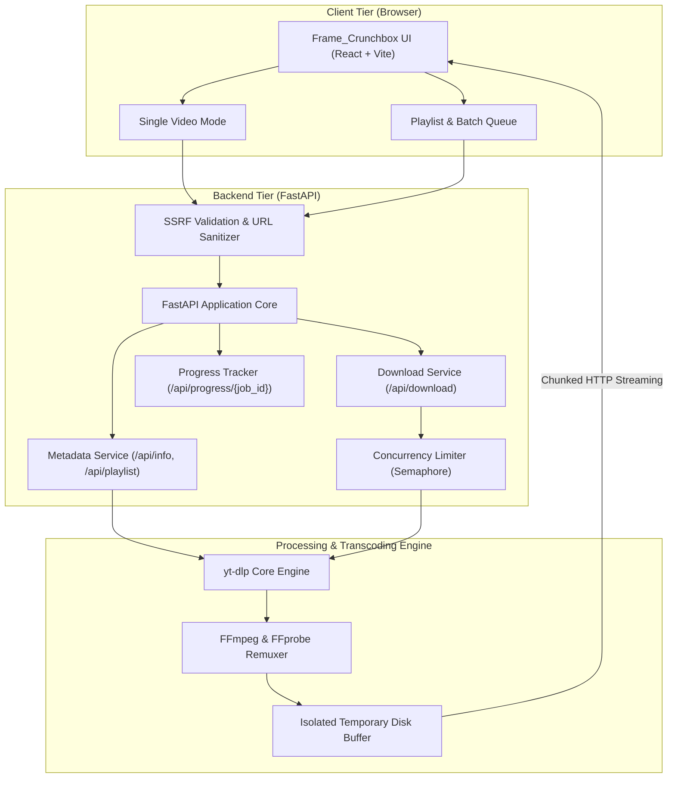
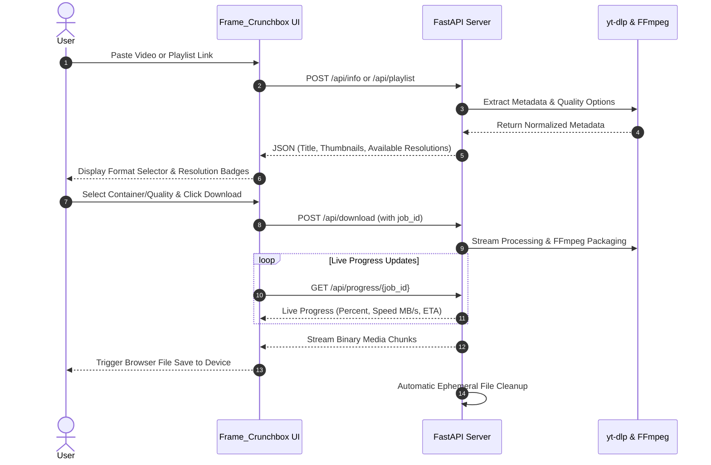

# Frame_Crunchbox — Video & Playlist Downloader

A modern, high-performance web application designed with an editorial Bauhaus aesthetic to inspect media metadata, discover available resolutions, and download single videos or full playlists as **MP4**, **WebM**, **MP3**, or **M4A** using **FastAPI**, **yt-dlp**, **FFmpeg**, and **React (Vite)**.

---

## 1. Architecture & System Overview



---

## 2. User Workflow



---

## 3. Core Capabilities

- **Single Video & Full Playlist Queue**:
  - Download individual videos on demand.
  - Fetch complete public playlists (up to 50 items in seconds) and download items one-by-one or in an automated queue.
- **Editorial Bauhaus Design**:
  - Restrained ivory/white palette with primary Bauhaus accents (red, cobalt blue, yellow).
  - Clear visual hierarchy, hard drop shadows, and high-contrast typography.
- **Live Progress & Streaming Metrics**:
  - Real-time percentage indicator, download speed (`MB/s`), and estimated time remaining (`ETA`).
  - Progress state during source transfer and final FFmpeg packaging.
- **Dynamic Quality Discovery**:
  - Discovers actual resolutions (1080p FHD, 720p HD, 480p, 360p) from source metadata.
  - Audio-only conversion to MP3 (192 kbps) or M4A via direct stream extraction.
- **Stateless & Memory Efficient**:
  - **No database required.** No SQLite, PostgreSQL, or Redis.
  - Chunked streaming prevents large media from buffering in Python RAM.
  - Temporary files are automatically purged immediately after delivery.
- **Security Hardened**:
  - Strict SSRF protection rejecting loopback, local/private subnets (`10.x`, `172.16-31.x`, `192.168.x`), and cloud metadata (`169.254.169.254`).
  - No shell interpolation (`shell=True` is prohibited). All operations execute via Python APIs.

---

## 4. Tech Stack

- **Frontend**: React 19, Vite, Lucide Icons, Pure Vanilla CSS (custom Bauhaus tokens).
- **Backend**: Python 3.11+, FastAPI, Uvicorn, `yt-dlp`, FFmpeg / FFprobe.
- **Target Environments**:
  - Backend: Docker / Render Web Service (with FFmpeg in container).
  - Frontend: Vercel Static Site deployment.

---

## 5. Prerequisites

Before running locally, verify your system has:

1. **Python 3.10+**:
   ```powershell
   python --version
   ```
2. **Node.js 18+ and npm**:
   ```powershell
   node -v
   npm -v
   ```
3. **FFmpeg and FFprobe** (must be available in your system `PATH`):
   ```powershell
   ffmpeg -version
   ffprobe -version
   ```
   > *Windows Tip:* Install via winget (`winget install Gyan.FFmpeg`) or Chocolatey (`choco install ffmpeg`), then restart your terminal.

---

## 6. Local Development Setup (Windows PowerShell)

### Step 1: Backend Setup

In your first PowerShell terminal:

```powershell
# Navigate to backend directory
cd backend

# (Optional) Create and activate a virtual environment
python -m venv .venv
.\.venv\Scripts\Activate.ps1

# Install backend dependencies
pip install -r requirements.txt

# Verify dependencies and tools
python -c "import fastapi, yt_dlp; print('Python dependencies OK')"
ffmpeg -version

# Launch the FastAPI server with hot-reload
uvicorn app.main:app --reload --host 127.0.0.1 --port 8000
```

- **API Base**: `http://127.0.0.1:8000`
- **Swagger Documentation**: `http://127.0.0.1:8000/docs`
- **Health Check**: `http://127.0.0.1:8000/api/health`

### Step 2: Frontend Setup

In a second PowerShell terminal:

```powershell
# Navigate to frontend directory
cd frontend

# Install dependencies
npm install

# Start the Vite development server
npm run dev
```

- **Local Application URL**: `http://localhost:5173`

---

## 7. API Reference

All routes are prefixed with `/api`.

### `GET /api/health`
Checks backend connectivity and verifies `yt-dlp` and `ffmpeg` availability.

**Response (`200 OK`)**:
```json
{
  "status": "ok",
  "yt_dlp_available": true,
  "ffmpeg_available": true
}
```

### `POST /api/info`
Extracts normalized video metadata, title, duration, and available resolutions.

**Request Body**:
```json
{
  "url": "https://www.youtube.com/watch?v=dQw4w9WgXcQ"
}
```

**Response (`200 OK`)**:
```json
{
  "title": "Rick Astley - Never Gonna Give You Up",
  "thumbnail": "https://i.ytimg.com/vi/dQw4w9WgXcQ/maxresdefault.jpg",
  "duration": 214,
  "extractor": "Youtube",
  "webpage_url": "https://www.youtube.com/watch?v=dQw4w9WgXcQ",
  "available_qualities": ["1080p", "720p", "480p", "360p"],
  "formats": [...]
}
```

### `POST /api/playlist`
Extracts flat playlist metadata (titles, durations, thumbnails, and item links) in under 2 seconds.

**Request Body**:
```json
{
  "url": "https://www.youtube.com/playlist?list=PL..."
}
```

### `POST /api/download`
Processes and streams the requested media file directly to the client.

**Request Body**:
```json
{
  "url": "https://www.youtube.com/watch?v=dQw4w9WgXcQ",
  "mode": "video",
  "container": "mp4",
  "quality": "1080p",
  "audio_format": "mp3",
  "job_id": "job_abc123"
}
```

**Response**:
- Binary stream (`video/mp4`, `video/webm`, or `audio/mpeg`).
- Header: `Content-Disposition: attachment; filename="Video Title [id].mp4"`

### `GET /api/progress/{job_id}`
Returns active download percentage, transferred bytes, live speed, and ETA.

---

## 8. Configuration & Environment Variables

### Backend (`backend/.env` or Render Dashboard)
| Variable | Default | Purpose |
|---|---|---|
| `FRONTEND_ORIGIN` | `http://localhost:5173` | Allowed origin for CORS in production (e.g. `https://frame-crunchbox.vercel.app`) |
| `TEMP_DIR` | `/tmp/video-downloader` | Ephemeral directory for intermediate media processing |
| `MAX_CONCURRENT_DOWNLOADS` | `1` | Max active parallel downloads allowed before returning 503 |
| `ENVIRONMENT` | `development` | Environment mode (`development` or `production`) |

### Frontend (`frontend/.env` or Vercel Dashboard)
| Variable | Default | Purpose |
|---|---|---|
| `VITE_API_URL` | `http://127.0.0.1:8000` | Target URL of the deployed FastAPI backend |

---

## 9. Production Deployment

### Backend on Render (Docker)
1. Go to [Render Dashboard](https://dashboard.render.com/) and create a **New Web Service**.
2. Select your repository.
3. Configure settings:
   - **Runtime**: `Docker`
   - **Root Directory**: `backend`
   - **Health Check Path**: `/api/health`
4. Set Environment Variables:
   - `FRONTEND_ORIGIN`: Your deployed Vercel frontend URL.
   - `TEMP_DIR`: `/tmp/video-downloader`
   - `MAX_CONCURRENT_DOWNLOADS`: `1`
5. Click **Deploy Web Service**.

> **Note on Free Tiers**: Render Free instances sleep after 15 minutes of inactivity and take ~45s to wake. Ephemeral storage is reset on container restarts.

### Frontend on Vercel
1. Go to [Vercel Dashboard](https://vercel.com/) and click **Add New Project**.
2. Select the repository and set **Root Directory** to `frontend`.
3. Framework Preset: `Vite`. Build Command: `npm run build`. Output Directory: `dist`.
4. Add Environment Variable:
   - `VITE_API_URL`: Your deployed Render backend URL (e.g., `https://frame-crunchbox.onrender.com`).
5. Click **Deploy**.

---

## 10. Automated Tests

Run backend tests using `pytest`:

```powershell
cd backend
pytest -v
```

Test suite validates:
- System health checks and dependency availability (`/api/health`).
- SSRF prevention against private, loopback, and metadata IPs.
- Input validation and bad request handling (`/api/info`, `/api/download`, `/api/playlist`).
- Filename sanitization and safe `Content-Disposition` encoding.
- Streaming responses with cleanup lifecycle verification.

---

## 11. Legal Notice & Terms of Use

This software is provided exclusively for processing and downloading media that users own or are legally authorized to access. Users are solely responsible for respecting platform Terms of Service, copyright laws, and intellectual property regulations. This software does not bypass paywalls, DRM protections, or access-control restrictions.
